# push_swap — Mapa do fluxo interno

---

## 0. Como ler este documento

### Legenda dos diagramas

| Estilo | Significado |
|---|---|
| Caixa verde, linha cheia | Implementado **e** ligado ao fluxo real do `main` |
| Caixa amarela | Implementado, mas **não é chamado** a partir do `main` (ou só usado a título de debug) |
| Caixa vermelha | Caminho de erro |
| Caixa cinzenta, linha tracejada | **Não existe no código** (planeado / ligação em falta) |

### Ficheiros lidos (todos confirmados)

| Ficheiro | Linhas (segundo o GitHub) |
|---|---|
| `main.c` | 31 |
| `push_swap.h` | 94 |
| `Makefile` | 34 |
| `disorder.c` | 51 |
| `parsing/parsing.c` | 58 |
| `parsing/parsing_utils.c` | 51 |
| `helpers/h_split.c` | 65 |
| `helpers/helpers.c` | 74 |
| `helpers/stack_helpers.c` | 60 |
| `helpers/stack_utils.c` | 15 |
| `actions/actions.c` | 68 |
| `actions/double_actions.c` | 28 |

Não lido: `.gitignore` (existe, mas não influencia o fluxo).

### Resumo em cinco linhas

1. Hoje o programa **lê, valida e guarda** os argumentos numa lista ligada (stack A), imprime-os para debug e termina.
2. Não existe nenhum algoritmo de ordenação, nem `stack_b` instanciada, nem contadores de operações.
3. As operações (`swap`, `push`, `rotate`, `reverse_rotate`, `ss`, `rr`, `rrr`) estão implementadas e imprimem a instrução, mas **nenhuma é chamada pelo `main`**.
4. `compute_disorder` está implementada, mas também **não é chamada**.
5. A flag escolhida (`--simple`, `--medium`, `--complex`, `--adaptive`) e `--bench` são guardadas em `t_options`, mas **nada as consome** além de um `printf` de debug.

---

## 1. Visão geral

### 1.1 Percurso completo (real + planeado)

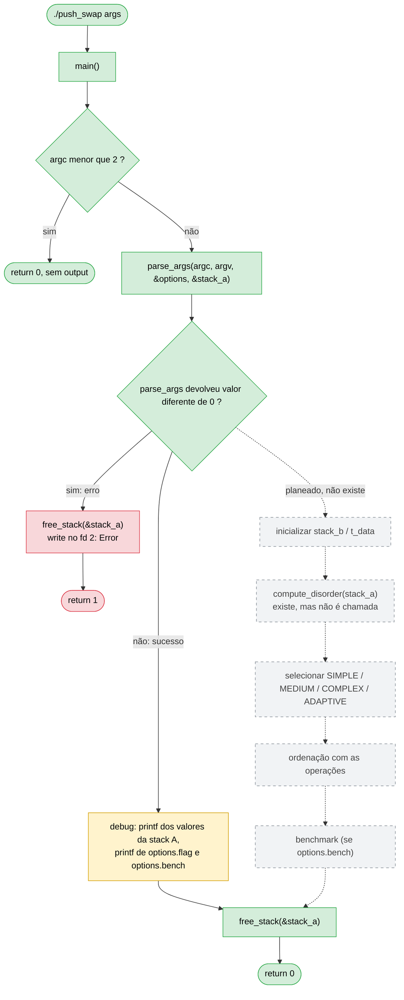

### 1.2 Estado por etapa

| Etapa | Estado | Onde |
|---|---|---|
| `main()` | Parcial (debug no fim) | `main.c` |
| Parsing | Implementado e ligado | `parsing/parsing.c` |
| Validação | Implementado e ligado | `parsing/parsing.c`, `parsing/parsing_utils.c` |
| Preparação (`stack_b`, `t_data`, desordem) | Não ligado | `disorder.c` (função existe) |
| Seleção do algoritmo | **Não existe** | só o enum `t_algorithm` e a flag |
| Ordenação | **Não existe** | — |
| Operações das stacks | Implementadas, não chamadas | `actions/*.c` |
| Benchmark | **Não existe** | só `t_data`, `t_actions` no header |
| Libertação de memória | Implementado | `helpers/stack_utils.c` |

---

## 2. Fluxo do `main` (`main.c`, 31 linhas)

### 2.1 Passo a passo

O `main.c` tem 31 linhas. Os passos abaixo seguem a ordem das instruções.

| Passo | Instrução | O que faz |
|---|---|---|
| 1 | `#include "push_swap.h"` e `#include <stdio.h>` | O `stdio.h` é incluído só no `main.c` (o header não o inclui). Serve para o `printf` |
| 2 | `t_stack *stack_a; t_stack *temp; t_options options;` | Declara a stack A, um ponteiro auxiliar para percorrer e as opções. **Não** declara `t_data` nem `stack_b` |
| 3 | `stack_a = NULL;` | Stack A começa vazia |
| 4 | `options.flag = ADAPTIVE;` | Algoritmo por omissão |
| 5 | `options.bench = 0;` | Benchmark desligado por omissão |
| 6 | `if (argc < 2) return (0);` | Sem argumentos: termina com 0 e **sem escrever nada** |
| 7 | `if (parse_args(argc, argv, &options, &stack_a))` | Qualquer valor diferente de 0 é erro |
| 7a | `free_stack(&stack_a);` | Liberta os nós já criados antes do erro |
| 7b | `write(2, "Error\n", 6);` | Escreve a mensagem no stderr |
| 7c | `return (1);` | Termina com código 1 |
| 8 | `temp = stack_a; while (temp) { printf("%d\n", temp->value); temp = temp->next; }` | Percorre a stack A e imprime cada valor. **Parece debug** (não confirmado que seja temporário) |
| 9 | `printf("Algorithm: %d\n", options.flag);` e `printf("Bench: %d\n", options.bench);` | Imprime os valores numéricos dos enums/flags |
| 10 | `free_stack(&stack_a); return (0);` | Liberta a stack e termina com 0 |

### 2.2 Fluxograma do `main`

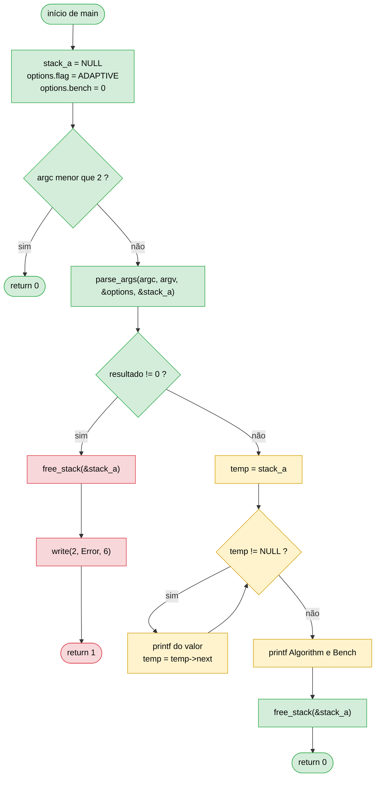

### 2.3 Implementado vs. planeado no `main`

| Item | Estado |
|---|---|
| Inicializar variáveis e opções | Implementado |
| Verificar `argc` | Implementado |
| Chamar `parse_args` e tratar erro | Implementado |
| Usar `stack_a` | Só para imprimir e libertar |
| Inicializar `stack_b` | **Não existe** (nem a variável) |
| Usar `t_data` | **Não existe** (o `main` usa variáveis soltas, não a struct) |
| Chamar `compute_disorder` | **Não existe** |
| Chamar algoritmo | **Não existe** |
| Benchmark | **Não existe** |

---

## 3. Parsing e validação

### 3.1 Grafo de chamadas (confirmado)

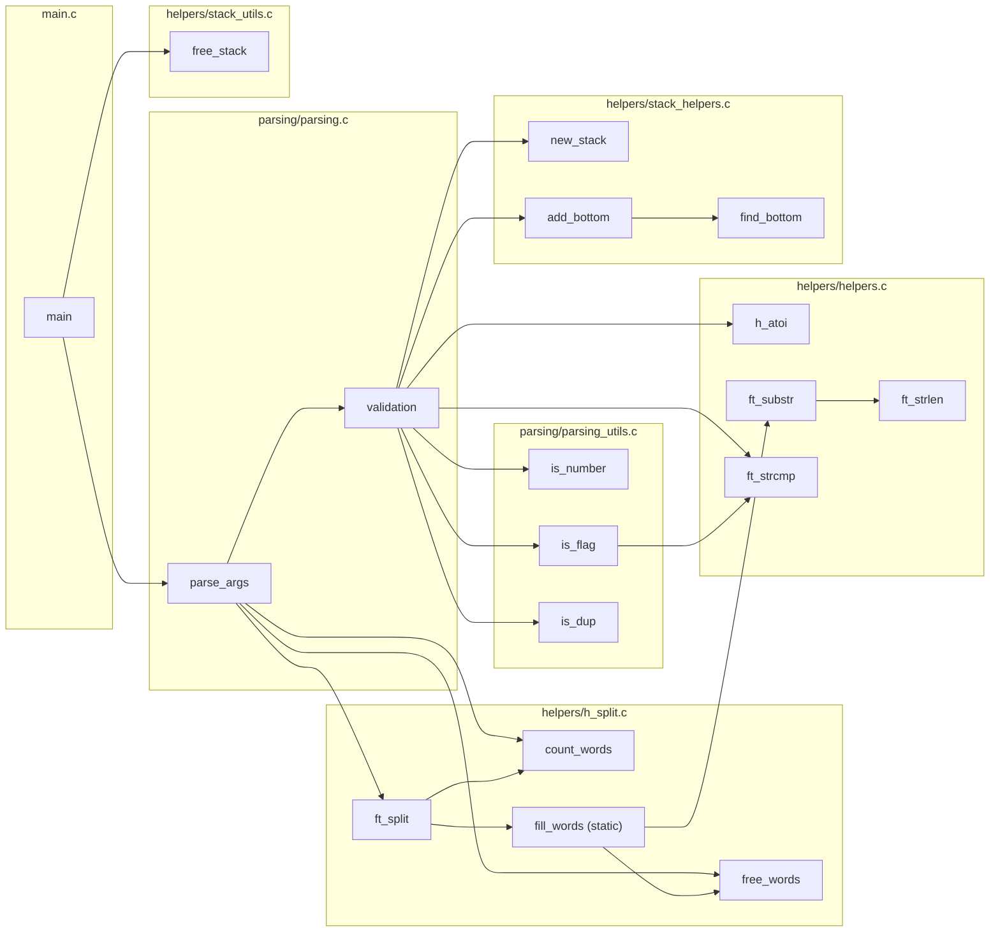

### 3.2 `parse_args` (`parsing/parsing.c`)

Assinatura: `int parse_args(int argc, char **argv, t_options *options, t_stack **stack_a)`.
Devolve 0 em sucesso e 1 em erro.

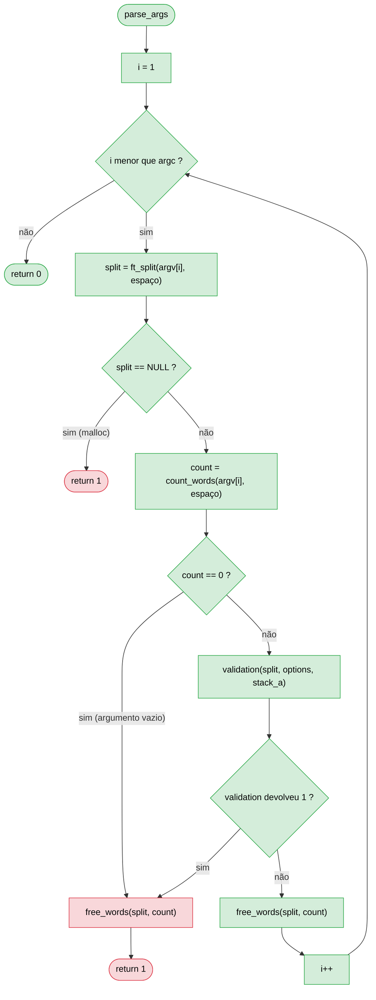

Pontos a reter (todos confirmados no código):

- Cada elemento de `argv` é dividido **só por espaços** (`' '`). Tabulações e outros separadores não são tratados como separadores.
- Por isso `./push_swap 3 1 2` e `./push_swap "3 1 2"` e uma mistura dos dois dão o mesmo resultado.
- Um argumento vazio (`""`) ou só com espaços dá `count == 0` e é tratado como **erro**.
- O vetor `split` é sempre libertado antes de passar ao argumento seguinte ou de devolver erro.

### 3.3 `validation` (`parsing/parsing.c`)

Assinatura: `int validation(char **tokens, t_options *op, t_stack **stack_a)`.
Processa os tokens de **um** elemento de `argv`. Devolve 0 em sucesso e 1 em erro.

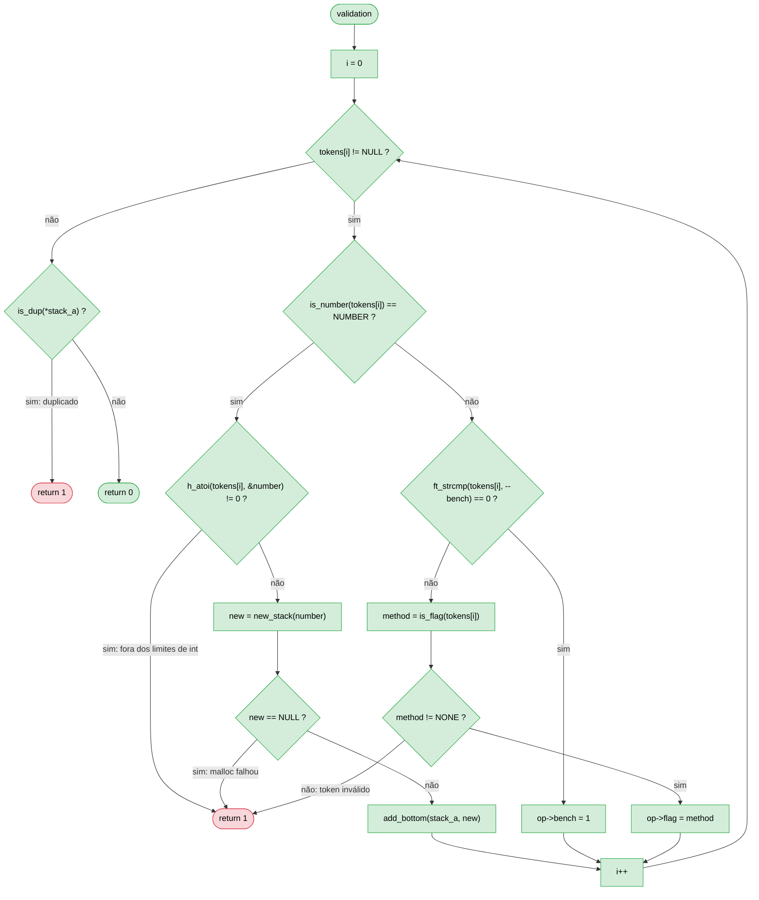

Pontos a reter:

- **Números, `--bench` e flags podem aparecer por qualquer ordem** e em qualquer posição.
- **A última flag de algoritmo vence**: cada flag válida sobrescreve `op->flag`.
- `--bench` é tratada **antes** de `is_flag`: `is_flag` não conhece `--bench`.
- **Duplicados**: `is_dup` corre no fim de cada `validation`, ou seja, depois de **cada elemento de `argv`**, sobre toda a stack acumulada até aí. Por isso `./push_swap 5 5` e `./push_swap "5 5"` falham ambos.
- `validation` **não liberta** os nós já criados quando falha. Quem liberta é o `main` com `free_stack(&stack_a)`.

### 3.4 Funções de validação e conversão

| Função | Ficheiro | O que faz | Devolve |
|---|---|---|---|
| `is_number(char *str)` | `parsing/parsing_utils.c` | Aceita sinal opcional (`+` ou `-`) seguido de **pelo menos um dígito**; qualquer outro carácter invalida | `NUMBER` ou `INVALID` |
| `is_flag(char *str)` | `parsing/parsing_utils.c` | Compara com `--simple`, `--medium`, `--complex`, `--adaptive` | `SIMPLE`, `MEDIUM`, `COMPLEX`, `ADAPTIVE` ou `INVALID` |
| `is_dup(t_stack *stack)` | `parsing/parsing_utils.c` | Compara todos os pares (ciclo duplo) | 1 se houver valores repetidos, senão 0 |
| `h_atoi(const char *str, int *number)` | `helpers/helpers.c` | Converte para `int`, acumulando em `long long`; verifica o limite **a cada dígito** | 1 se sair de `int`, senão 0 (escreve em `*number`) |
| `ft_strcmp(char *s1, char *s2)` | `helpers/helpers.c` | Diferença do primeiro byte diferente (como `unsigned char`) | 0 se iguais |

Detalhes do `h_atoi`:

- Aceita `-2147483648` (usa `(long long)INT_MAX + 1` como limite do lado negativo) e rejeita `2147483648`.
- Não valida os caracteres: **assume que `is_number` já validou** a string.
- Zeros à esquerda são aceites (`007` vira 7).

### 3.5 `ft_split` por dentro (`helpers/h_split.c`)

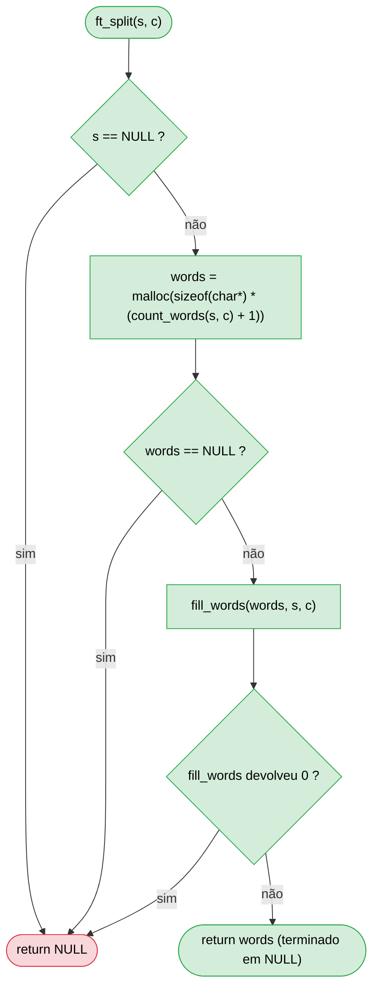

| Função | Responsabilidade |
|---|---|
| `count_words(s, c)` | Conta palavras: um carácter diferente de `c` cujo anterior é `c` (ou é o primeiro) |
| `fill_words` (`static`) | Salta separadores, mede a palavra, cria cada uma com `ft_substr`; se um `ft_substr` falhar, faz `free_words(words, j)` e devolve 0 |
| `ft_substr(s, start, len)` | Aloca e copia uma subcadeia (usa `ft_strlen`) |
| `free_words(words, count)` | Liberta as `count` strings e depois o vetor |

### 3.6 Percurso de um argumento: de `argv` a nó da stack A

Exemplo: `./push_swap "3 -1 --medium" 5`

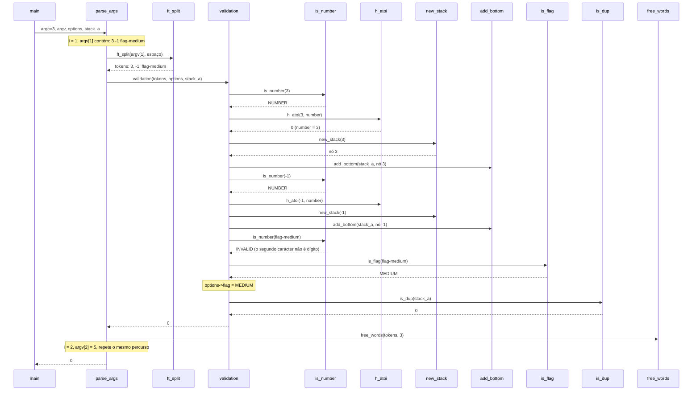

Resultado em memória: stack A = `3 -> -1 -> 5 -> NULL`, com `stack_a` a apontar para o nó `3`.
O **primeiro número dado é o topo** da stack, porque `add_bottom` acrescenta sempre ao fim da lista.

Percurso de um token numérico, passo a passo:

1. `argv[i]` (texto) → `ft_split` → vetor de tokens (cópias alocadas).
2. `is_number` confirma a forma (`[+-]?[0-9]+`).
3. `h_atoi` converte para `int` e verifica o intervalo.
4. `new_stack(number)` aloca um `t_stack` com `value = number` e `next = NULL`.
5. `add_bottom(stack_a, new)` liga-o ao fim (ou torna-o o primeiro, se a stack estiver vazia).
6. O token (cópia alocada) é libertado por `free_words` no fim desse elemento de `argv`. **O nó guarda o `int`, não o texto.**

### 3.7 Erros possíveis

| Situação | Onde é detetada | O que acontece |
|---|---|---|
| Token inválido (letras, `+` ou `-` sozinhos, `1a`, `--foo`) | `validation`: nem número, nem `--bench`, nem flag | `return 1` |
| Flag inválida (qualquer `--xyz` que não seja `--bench`, `--simple`, `--medium`, `--complex`, `--adaptive`) | `validation`: `is_flag` devolve 0 (`INVALID`) | `return 1`. **Não há mensagem específica**: é o mesmo erro do token inválido |
| Número fora de `int` | `h_atoi` devolve 1 | `validation` devolve 1 |
| Valores duplicados | `is_dup` no fim de `validation` | `validation` devolve 1 |
| Argumento vazio ou só com espaços | `parse_args`: `count == 0` | `return 1` |
| `malloc` falha em `ft_split` | `parse_args`: `split == NULL` | `return 1` |
| `malloc` falha em `ft_substr` | `fill_words` liberta o que já criou | `ft_split` devolve `NULL` e `parse_args` devolve 1 |
| `malloc` falha em `new_stack` | `validation`: `new == NULL` | `return 1` |
| `argc < 2` | `main` | **Não é erro**: `return 0` sem output |

Em qualquer caso, o `main` faz `free_stack(&stack_a)`, escreve `Error` no stderr (fd 2) e devolve 1.

### 3.8 Quem aloca e quem liberta

| Memória | Alocada em | Libertada em |
|---|---|---|
| Vetor `split` e as strings | `ft_split` / `fill_words` / `ft_substr` | `free_words`, chamada por `parse_args` (nos dois caminhos) |
| Nós da stack A | `new_stack` (chamada por `validation`) | `free_stack`, chamada pelo `main` (no erro e no fim) |
| Stack B | **Não existe** | — |

---

## 4. Preparação e seleção do algoritmo

### 4.1 `compute_disorder` (`disorder.c`)

Assinatura: `float compute_disorder(t_stack *a)`.
**Estado: implementada, mas não é chamada por nenhuma função.**

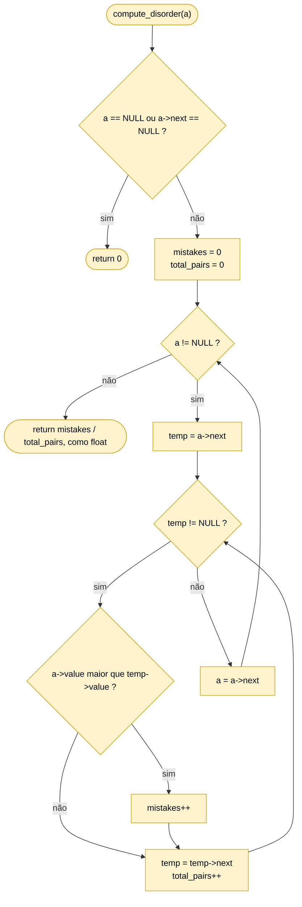

- Mede a fração de **pares fora de ordem** (inversões) sobre o total de pares. O resultado fica entre 0 (ordenada) e 1 (invertida).
- Exemplo: stack `3 1 2` → pares `(3,1)` e `(3,2)` são inversões, `(1,2)` não → `2 / 3 = 0,666…`.
- Usa a stack **sem a alterar** (avança com o ponteiro local `a`).
- No fim do ficheiro há um `main` de teste **comentado**, que usa nomes antigos (`ft_stackadd_bottom`, `ft_stacknew`, `ft_compute_disorder`) que já não existem.
- O tipo de retorno (`float`) é o mesmo do campo `t_data.disorder`, mas a ligação entre os dois **não existe** (nada preenche esse campo).

### 4.2 Como `t_options` é usada

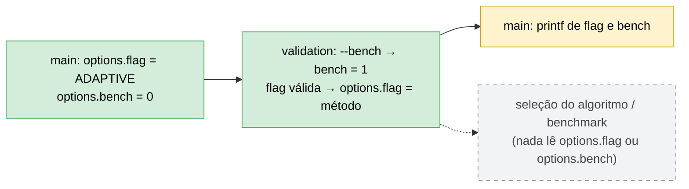

| Campo | Tipo | Escrito por | Lido por |
|---|---|---|---|
| `flag` | `t_algorithm` | `main` (omissão `ADAPTIVE`), `validation` (flags) | só o `printf` do `main` |
| `bench` | `int` | `main` (omissão 0), `validation` (`--bench` põe 1) | só o `printf` do `main` |

### 4.3 Seleção `SIMPLE` / `MEDIUM` / `COMPLEX` / `ADAPTIVE`

**Não existe código de seleção nem de algoritmos.**
O `Makefile` compila apenas os 10 ficheiros listados na secção 8, nenhum com algoritmos de ordenação.
Existe só:

- o enum `t_algorithm` (`NONE=0`, `SIMPLE=1`, `MEDIUM=2`, `COMPLEX=3`, `ADAPTIVE=4`);
- o parsing das flags, que preenche `options.flag`.

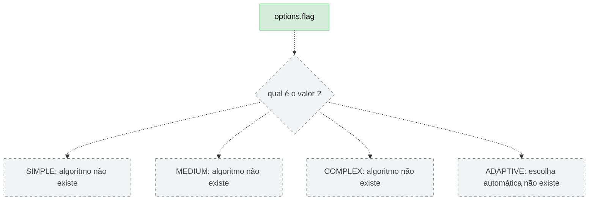

> **Não confirmado**: se `ADAPTIVE` vai usar `compute_disorder` para escolher entre os outros. O código não o diz. A relação é apenas plausível pela existência das duas coisas, mas não está escrita em nenhum ficheiro.

---

## 5. Operações das stacks (`actions/actions.c` e `actions/double_actions.c`)

### 5.1 Resumo

Todas as operações:

- recebem **ponteiros para o ponteiro da cabeça** (`t_stack **`), para poderem mudar qual é o primeiro nó;
- **imprimem a instrução diretamente** com `write(1, ...)`, dentro da própria função;
- **não atualizam nenhum contador** (não têm acesso a `t_data`);
- **não são chamadas por ninguém** fora de `double_actions.c` (o `main` não as usa).

O parâmetro `char name` decide o que se imprime: `'a'` ou `'b'` imprime a instrução dessa stack, e **qualquer outro valor não imprime nada**. Isto é usado pelas operações duplas.

| Função | Ficheiro | Guarda (se verdadeira, não faz nada) | Instruções impressas |
|---|---|---|---|
| `swap(t_stack **stk, char name)` | `actions/actions.c` | `!stk`, `!*stk` ou só 1 nó | `sa` / `sb` |
| `push(t_stack **src, t_stack **dest, char name)` | `actions/actions.c` | `!src`, `!*src` ou `!dest` | `pa` (se `name == 'a'`) / `pb` (se `name == 'b'`) |
| `rotate(t_stack **stk, char name)` | `actions/actions.c` | `!stk`, `!*stk` ou só 1 nó | `ra` / `rb` |
| `reverse_rotate(t_stack **stk, char name)` | `actions/actions.c` | `!stk`, `!*stk` ou só 1 nó | `rra` / `rrb` |
| `ss(t_stack **a, t_stack **b)` | `actions/double_actions.c` | ver 5.4 | `ss` |
| `rr(t_stack **a, t_stack **b)` | `actions/double_actions.c` | ver 5.4 | `rr` |
| `rrr(t_stack **a, t_stack **b)` | `actions/double_actions.c` | ver 5.4 | `rrr` |

> No `push`, o `name` é o nome da **stack de destino** na impressão (`'a'` → `pa`). O código não obriga a que `src`/`dest` sejam coerentes com `name`: essa convenção fica a cargo de quem chama (inferido do código; ainda não há nenhuma chamada para confirmar).

### 5.2 Grafo de chamadas das operações

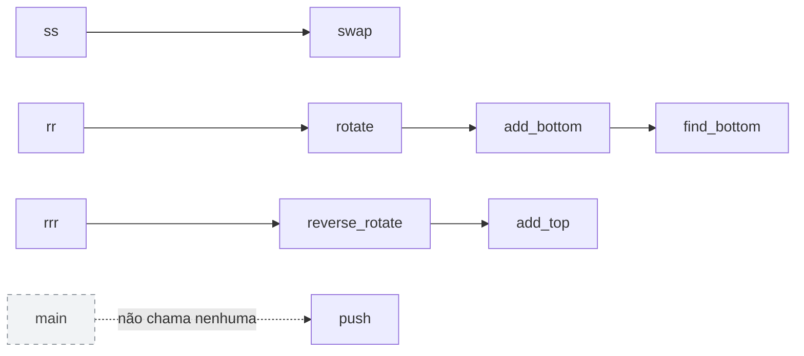

### 5.3 O que acontece aos ponteiros

Nos diagramas, `a` é a cabeça da stack (o topo) e `n1`, `n2`, `n3` são nós.

**`swap(&a, 'a')`** troca os dois primeiros nós.

```text
temp = n1;            // guarda o 1.º
*a = n2;              // a cabeça passa para o 2.º
temp->next = n3;      // o antigo 1.º aponta para o que vinha a seguir ao 2.º
n2->next = temp;      // o 2.º aponta para o antigo 1.º
```

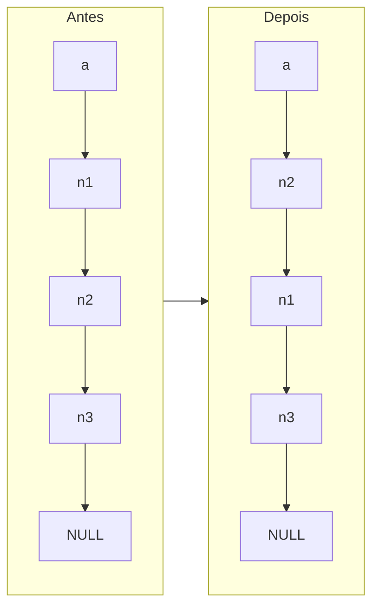

**`push(&src, &dest, 'a')`** move o topo de `src` para o topo de `dest`.

```text
temp_src = *src;          // s1
*src = (*src)->next;      // src passa a apontar para s2
temp_dest = *dest;        // d1 (pode ser NULL)
*dest = temp_src;         // dest passa a apontar para s1
(*dest)->next = temp_dest;// s1 aponta para o antigo topo de dest
```

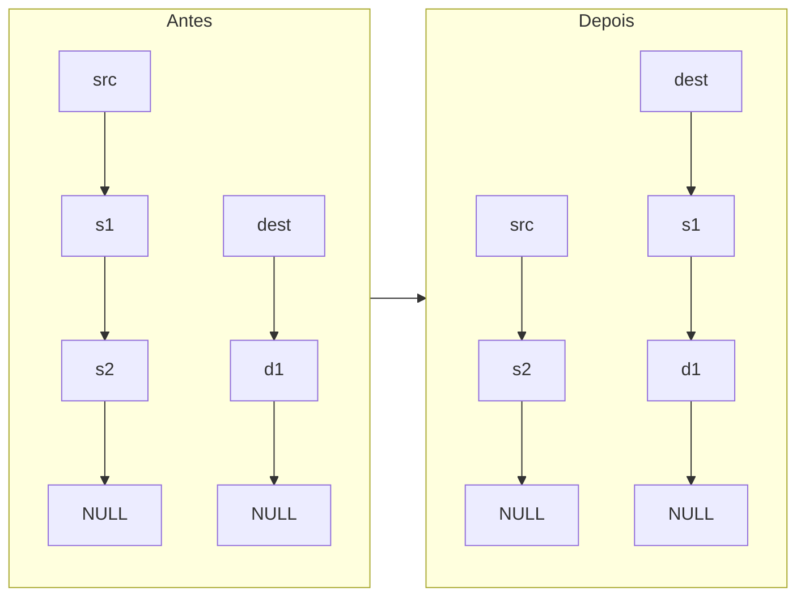

**`rotate(&a, 'a')`** o primeiro nó vai para o fim.

```text
temp = *a;            // n1
*a = (*a)->next;      // a passa para n2
temp->next = NULL;    // n1 fica solto
add_bottom(a, temp);  // find_bottom(n3)->next = n1
```

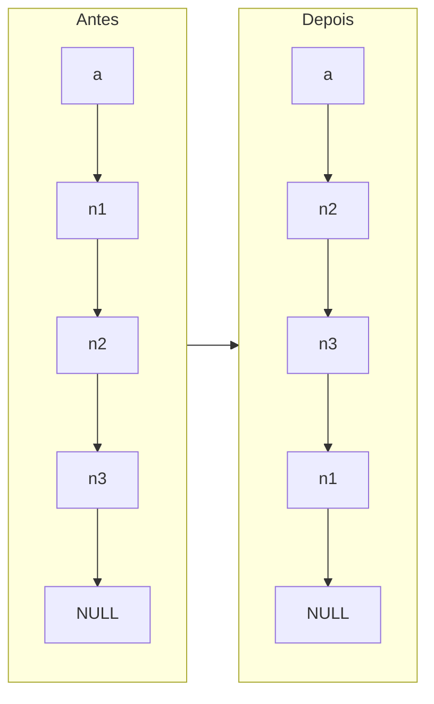

**`reverse_rotate(&a, 'a')`** o último nó vai para o início.

```text
temp = *a;
while (temp->next->next)  // pára no penúltimo (n2)
    temp = temp->next;
add_top(a, temp->next);   // n3 passa a ser a cabeça, n3->next = n1
temp->next = NULL;        // o penúltimo (n2) passa a ser o último
```

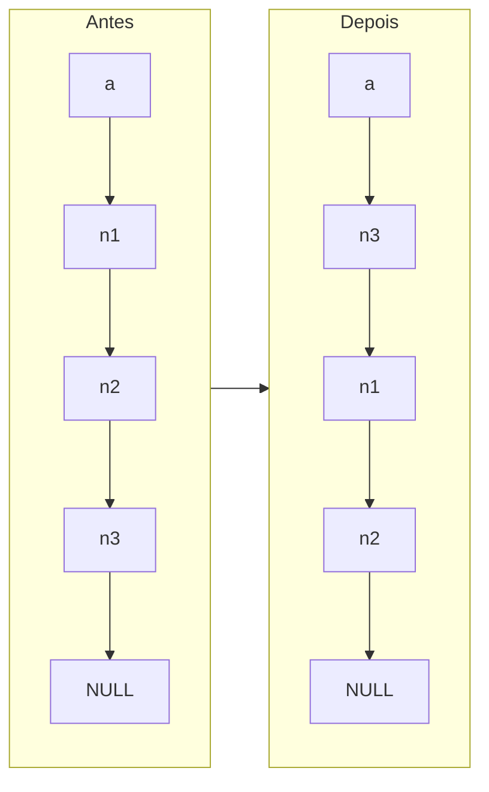

`add_top(stk, new)` guarda a cabeça antiga, faz `*stk = new` e `new->next = antiga cabeça`. A ordem em `reverse_rotate` (primeiro `add_top`, depois `temp->next = NULL`) funciona porque `add_top` só mexe em `new->next`, não em `temp->next`.

### 5.4 Operações duplas (`ss`, `rr`, `rrr`)

As três têm a **mesma estrutura**:

1. **Guarda**: não faz nada se `a` ou `b` forem `NULL`, **ou** se *ambas* as stacks estiverem "inoperáveis" (vazias ou com um só nó).
2. Chama a operação individual em `a` e em `b`, com `name = 0` (por isso nenhuma das duas imprime).
3. Escreve a linha da operação dupla (`ss`, `rr` ou `rrr`).

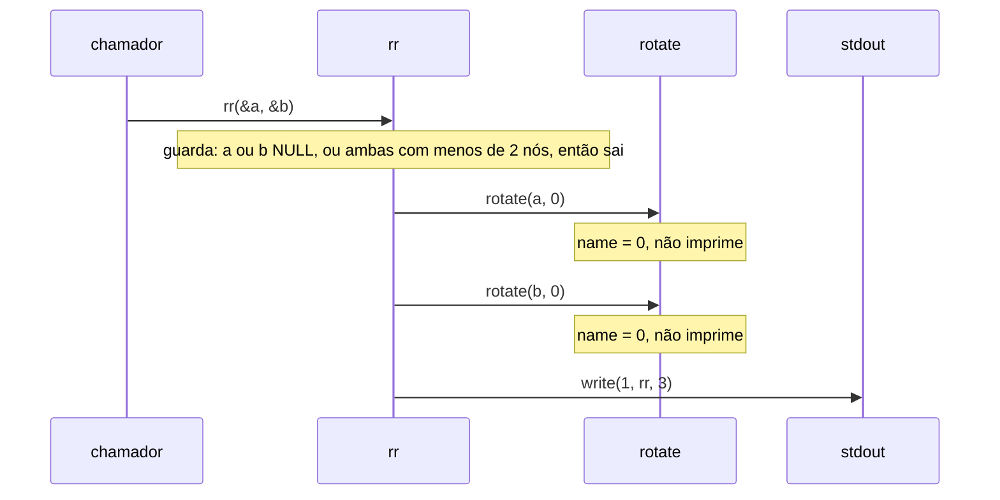

Consequência confirmada: se **só uma** das stacks tiver 2 ou mais nós, a guarda não dispara. A operação individual da outra stack não faz nada (tem a sua própria guarda), mas a linha `rr` é impressa na mesma.

### 5.5 Operações vs. instrução impressa

| Operação | Chamada | Instrução |
|---|---|---|
| swap A | `swap(&a, 'a')` | `sa` |
| swap B | `swap(&b, 'b')` | `sb` |
| swap duplo | `ss(&a, &b)` | `ss` |
| push para A | `push(&b, &a, 'a')` | `pa` |
| push para B | `push(&a, &b, 'b')` | `pb` |
| rotate A | `rotate(&a, 'a')` | `ra` |
| rotate B | `rotate(&b, 'b')` | `rb` |
| rotate duplo | `rr(&a, &b)` | `rr` |
| reverse rotate A | `reverse_rotate(&a, 'a')` | `rra` |
| reverse rotate B | `reverse_rotate(&b, 'b')` | `rrb` |
| reverse rotate duplo | `rrr(&a, &b)` | `rrr` |

---

## 6. Benchmark

### 6.1 Estado

**Só existem as declarações no `push_swap.h`.** Nenhuma função usa `t_data` ou `t_actions`, e o `main` nem declara uma variável `t_data`.

### 6.2 `t_data` (declarada em `push_swap.h`)

```c
typedef struct s_data
{
    t_stack *a;
    t_stack *b;
    t_options options;
    float disorder;
    size_t ops[OP_COUNT];
} t_data;
```

| Campo | Tipo | Função prevista pela estrutura | Estado real |
|---|---|---|---|
| `a` | `t_stack *` | Stack A | O `main` usa uma variável `stack_a` separada, **não este campo** |
| `b` | `t_stack *` | Stack B | Nunca criada |
| `options` | `t_options` | Opções | O `main` usa uma variável `options` separada |
| `disorder` | `float` | Resultado de `compute_disorder` | Nunca preenchido |
| `ops` | `size_t[OP_COUNT]` | Um contador por operação | Nunca incrementado |

### 6.3 `t_actions` e o índice no array `ops`

`OP_COUNT` vale **11**, porque é o último enumerador (depois de `RRR`), por isso `ops` tem 11 posições.

| Enumerador | Índice | Operação |
|---|---|---|
| `SA` | 0 | `sa` |
| `SB` | 1 | `sb` |
| `SS` | 2 | `ss` |
| `PA` | 3 | `pa` |
| `PB` | 4 | `pb` |
| `RA` | 5 | `ra` |
| `RB` | 6 | `rb` |
| `RR` | 7 | `rr` |
| `RRA` | 8 | `rra` |
| `RRB` | 9 | `rrb` |
| `RRR` | 10 | `rrr` |
| `OP_COUNT` | 11 | tamanho do array |

### 6.4 Percurso de uma operação até ao contador

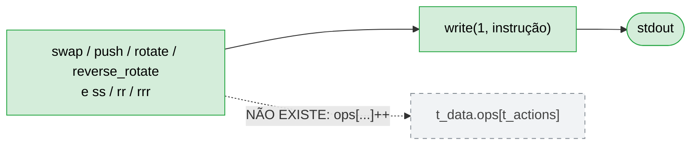

Hoje o percurso de uma operação **acaba no `write`**. Não há incremento de contador.

Observação factual sobre a ligação em falta: as assinaturas atuais das operações (por exemplo `swap(t_stack **stk, char name)`) **não recebem `t_data` nem um ponteiro para `ops`**, por isso, tal como estão, não conseguem alcançar os contadores. A forma de os ligar não está definida em nenhum ficheiro.

`--bench` apenas faz `options.bench = 1`. **Não existe código que imprima estatísticas.**

---

## 7. Estruturas e percurso dos dados

### 7.1 Estruturas

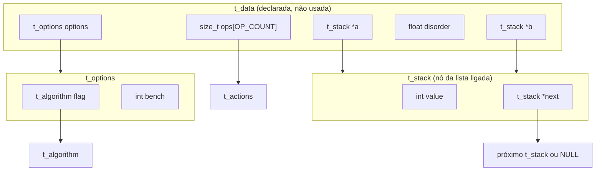

### 7.2 Enums

| Enum | Valores (em ordem, a começar em 0) | Quem o usa |
|---|---|---|
| `t_algorithm` | `NONE`, `SIMPLE`, `MEDIUM`, `COMPLEX`, `ADAPTIVE` | `t_options.flag`; `is_flag` devolve os valores 1 a 4; `validation` compara com `NONE` |
| `t_type` | `INVALID`, `NUMBER`, `FLAG` | `is_number` devolve `INVALID` ou `NUMBER`; `is_flag` devolve `INVALID` em caso de falha |
| `t_actions` | `SA` … `RRR`, `OP_COUNT` | Só declarado |

Notas confirmadas no código:

- O valor `FLAG` de `t_type` **nunca é devolvido** por nenhuma das funções lidas.
- `is_flag` devolve `int` e, quando não encontra nada, devolve `INVALID` (do enum `t_type`, valor 0). `validation` compara esse resultado com `NONE` (do enum `t_algorithm`, também valor 0). **Funciona porque os dois valem 0**, mas são enums diferentes.

### 7.3 Percurso dos dados

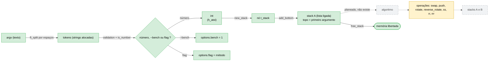

---

## 8. Mapa de ficheiros

### 8.1 Estrutura (confirmada pelo `Makefile`)

```text
push_swap/
├── main.c
├── push_swap.h
├── Makefile
├── disorder.c
├── .gitignore                 (existe; não lido)
├── parsing/
│   ├── parsing.c
│   └── parsing_utils.c
├── helpers/
│   ├── h_split.c
│   ├── helpers.c
│   ├── stack_helpers.c
│   └── stack_utils.c
└── actions/
    ├── actions.c
    └── double_actions.c
```

Não existe `libft` nem pasta de algoritmos.

### 8.2 Responsabilidade de cada ficheiro

| Ficheiro | Funções | Responsabilidade |
|---|---|---|
| `main.c` | `main` | Ponto de entrada; orquestra parsing, debug e libertação |
| `push_swap.h` | — | Tipos (`t_stack`, `t_algorithm`, `t_type`, `t_options`, `t_actions`, `t_data`) e protótipos |
| `parsing/parsing.c` | `parse_args`, `validation` | Percorrer `argv`, validar e construir a stack A |
| `parsing/parsing_utils.c` | `is_number`, `is_flag`, `is_dup` | Testes de validação |
| `helpers/h_split.c` | `ft_split`, `count_words`, `free_words`, `fill_words` (static) | Dividir strings por um separador |
| `helpers/helpers.c` | `h_atoi`, `ft_substr`, `ft_strlen`, `ft_strcmp` | Conversão e funções de strings |
| `helpers/stack_helpers.c` | `stacksize`, `find_bottom`, `add_bottom`, `new_stack`, `add_top` | Criar e ligar nós |
| `helpers/stack_utils.c` | `free_stack` | Libertar a lista |
| `actions/actions.c` | `push`, `reverse_rotate`, `rotate`, `swap` | Operações numa stack |
| `actions/double_actions.c` | `rrr`, `rr`, `ss` | Operações em ambas as stacks |
| `disorder.c` | `compute_disorder` | Métrica de desordem |

### 8.3 Dependências entre módulos

Todos os `.c` incluem `push_swap.h`.

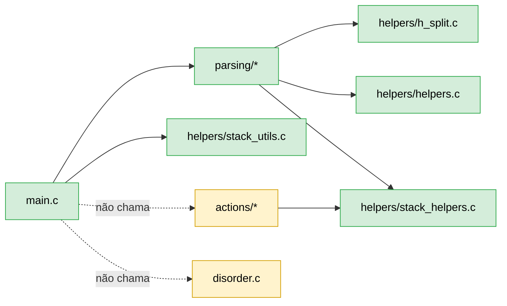

### 8.4 `Makefile`

- `CC = cc`, `CFLAGS = -Wall -Wextra -Werror -I.`
- Compila os 10 `.c` listados (`SRC`) em `.o` e liga-os para `push_swap`.
- Regras: `all`, `$(NAME)`, `clean`, `fclean`, `re`, `.PHONY`.
- **Não tem** regra `bonus`.
- Os `.o` não dependem de `push_swap.h`: se só o header mudar, o `make` não recompila (precisas de `make re`).

---

## 9. Estado de desenvolvimento

### 9.1 Checklist

**Implementado**

- [x] Leitura de argumentos: números separados, lista numa só string, ou mistura
- [x] Validação: só inteiros, dentro dos limites de `int`, sem duplicados
- [x] Flags `--simple`, `--medium`, `--complex`, `--adaptive`, `--bench` reconhecidas e guardadas em `t_options`
- [x] Mensagem `Error` no stderr e código de saída 1 nos erros
- [x] Lista ligada para a stack e funções de apoio (`new_stack`, `add_top`, `add_bottom`, `find_bottom`, `stacksize`)
- [x] Operações simples: `swap`, `push`, `rotate`, `reverse_rotate`
- [x] Operações duplas: `ss`, `rr`, `rrr`
- [x] Libertação da stack (`free_stack`) e dos tokens (`free_words`)
- [x] `Makefile` com `all`, `clean`, `fclean`, `re`

**Parcialmente implementado**

- [~] `main`: faz o parsing, mas o fim é só um `printf` de debug
- [~] `compute_disorder`: está escrita e a lógica está completa, mas **ninguém a chama**; o ficheiro tem um teste comentado com nomes antigos
- [~] `t_options`: preenchida corretamente, mas só lida pelo `printf` do `main`
- [~] Operações: funcionam isoladamente, mas **não há nenhum chamador**
- [~] `t_data`, `t_actions`, `OP_COUNT`: declarados, nunca usados
- [~] `t_type.FLAG`: existe no enum, nunca devolvido

**Por implementar**

- [ ] Algoritmos `SIMPLE`, `MEDIUM`, `COMPLEX`
- [ ] Lógica de `ADAPTIVE` (a escolha automática)
- [ ] Seleção do algoritmo a partir de `options.flag`
- [ ] Criação de `stack_b` (e uso de `t_data`)
- [ ] Verificação de "já ordenada" antes de ordenar
- [ ] Contagem de operações em `t_data.ops`
- [ ] Impressão do benchmark (`--bench`)
- [ ] Regra `bonus` / `checker`

### 9.2 Ligações entre funções que ainda faltam

| De | Para | Estado |
|---|---|---|
| `main` | `compute_disorder` | Não existe |
| `main` | `t_data` (usar a struct em vez de variáveis soltas) | Não existe |
| `main` | algoritmo de ordenação | Não existe |
| algoritmos | `push`, `swap`, `rotate`, `reverse_rotate`, `ss`, `rr`, `rrr` | Não existe (não há algoritmos) |
| operações | `t_data.ops[...]` | Não existe (as operações não recebem `t_data`) |
| `options.flag` | seleção do algoritmo | Não existe |
| `options.bench` | impressão do benchmark | Não existe |
| `compute_disorder` | `t_data.disorder` | Não existe |

### 9.3 Observações técnicas (sem alterar o código)

Estas notas descrevem o que o código **faz hoje**, sem propor alterações.

1. **`printf` no `main`**: as instruções de debug usam `printf`. Convém confirmar no enunciado da tua versão do projeto se `printf` é permitida (não verifiquei o enunciado).
2. **Enums misturados**: `is_flag` devolve `INVALID` (de `t_type`) e `validation` compara com `NONE` (de `t_algorithm`). Funciona só porque ambos valem 0.
3. **`stacksize`** está definida e declarada, mas não é chamada em nenhum dos ficheiros lidos.
4. **Custo de `is_dup`**: corre sobre toda a stack depois de **cada elemento de `argv`**. Com muitos argumentos separados isso repete a comparação de todos os pares várias vezes.
5. **Separador**: só o espaço divide tokens. Um argumento com tabulações é tratado como um único token (e falha em `is_number`).
6. **Flag inválida**: `--xyz` não tem mensagem própria; cai no mesmo erro que qualquer token inválido.
7. **`h_atoi` não valida caracteres**: depende de `is_number` ter corrido antes (que é o que acontece em `validation`).
8. **Operações duplas**: imprimem a instrução mesmo quando só uma das stacks se mexe (ver 5.4).
9. **`ft_strcmp`** recebe `char *` (não `const char *`).